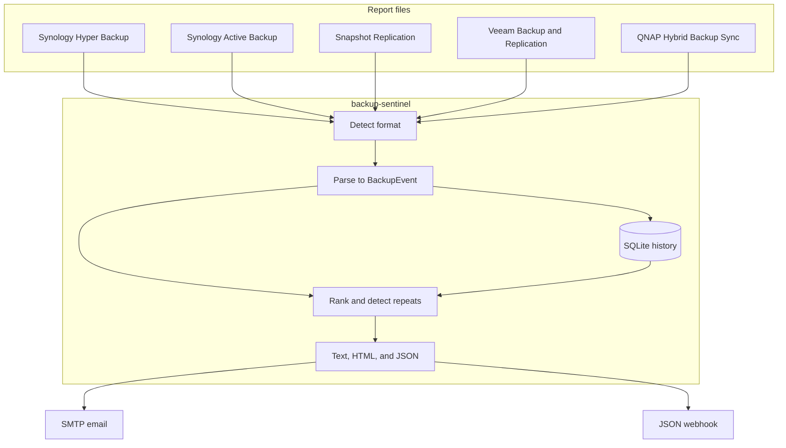

# backup-sentinel

One daily digest for backup jobs that already report on their own.

Synology Hyper Backup, Active Backup for Business, Snapshot Replication, Veeam Backup & Replication, and QNAP Hybrid Backup Sync each send a different status mail. backup-sentinel reads those reports, ranks every job `critical`, `warning`, or `ok`, and remembers which failures repeated across days. The digest goes to stdout, and optionally to SMTP and a JSON webhook.

The reports in [`samples/`](samples/) are synthetic. Host names stay under `example.internal`. Mailboxes stay under `example.invalid`.

[](https://github.com/lp830623/CODEX_DEMO_backup-sentinel/actions/workflows/ci.yml)
[](https://www.python.org/)
[](LICENSE)

## Features

- Five parsers with signature detection for plain text, HTML session reports, and `.eml` notifications
- One normalized event per job, or per Veeam object when the report lists virtual machines
- Urgency ranking, consecutive-day streaks, and a count of failures inside a lookback window
- Chronic warnings promoted to critical once a streak crosses a threshold
- SQLite history so a later run still sees earlier days
- SMTP (plain text plus HTML) and a generic JSON webhook
- `--dry-run` and `--fail-on` for safe previews and monitoring hooks

## Architecture



| Module | Role |
| --- | --- |
| `parsers` | Detect a product phrase and emit `BackupEvent` records |
| `history` | Store one observation per fingerprint per calendar day |
| `digest` | Compute streaks, chronic flags, escalation, and sort order |
| `render` | Plain text for humans, HTML for mail, JSON for webhooks |
| `delivery` | SMTP and HTTP POST |
| `cli` | `run`, `report`, `parse`, and `sources` |

A fingerprint is `source|job|target`, compared case-insensitively. Re-importing the same job on the same day replaces the stored row. Escalation is computed when the digest is built, so a new `chronic_after_days` value applies on the next run.

## Quickstart

Requires Python 3.11+.

```bash
python -m venv .venv
source .venv/bin/activate
pip install -e ".[dev]"

backup-sentinel run --config config.example.yaml --date 2026-10-14
```

That command reads every report under `samples/`. The inbox is three days of the same lab jobs, so one run already has the history it needs to show streaks. `--date` pins the digest. Omit it and the tool uses the latest date it ingested.

Delivery is off in the example config. Stderr says so:

```text
delivery: email disabled
delivery: webhook disabled
```

Preview without writing `state/history.db`:

```bash
backup-sentinel run --config config.example.yaml --date 2026-10-14 --dry-run
```

Inspect one file:

```bash
backup-sentinel parse samples/2026-10-14/veeam.html
backup-sentinel sources
```

`report` reprints a digest from history without reading the inbox again. That is the command to use when delivery failed and the reports are already stored.

## Sample output

This is stdout from `backup-sentinel run --config config.example.yaml --date 2026-10-14 --dry-run`. The `Generated` clock is the time of the run in the configured timezone.

```text
Backup Sentinel daily digest — 2026-10-14
Generated: 2026-10-14 17:00 UTC
Lookback: 7 days · chronic after 3 consecutive non-ok days

Summary: 3 critical · 2 warning · 2 ok

CRITICAL (3)
  Synology Hyper Backup · Documents-Daily → vault-lab.example.internal
    Failed · 3-day streak · 3 failures in 7 days · chronic
    The backup destination is offline. (error 31)
  Veeam Backup & Replication · Nightly-VM-Backup → vm-db-01
    Failed · 3-day streak · 3 failures in 7 days · chronic
    Production datastore is inaccessible
  Synology Snapshot Replication · Volume-Replica → dr-lab.example.internal
    Failed · 1-day streak · 1 failure in 7 days
    Network connection timed out while transferring the latest snapshot.

WARNING (2)
  Synology Active Backup for Business · Fileserver-Lab → fileserver-lab
    Warning · 2-day streak · 2 failures in 7 days
    A volume was skipped because it was offline.
  Veeam Backup & Replication · Nightly-VM-Backup → vm-app-01
    Warning · 1-day streak · 2 failures in 7 days
    Changed block tracking is disabled

OK (2)
  QNAP Hybrid Backup Sync · Offsite-Photos → vault-lab.example.internal:/share/photos
    Completed · 1 failure in 7 days
  Veeam Backup & Replication · Nightly-VM-Backup → vm-web-01
    Success
```

Reading the sample inbox as an on-call engineer:

- **Documents-Daily** and **vm-db-01** failed on the 12th, 13th, and 14th. Three consecutive failures cross the chronic threshold.
- **Volume-Replica** replicated cleanly, then timed out on the 14th. The streak is one day.
- **Fileserver-Lab** succeeded on the 12th and warned on the next two days.
- **vm-app-01** warned, succeeded, then warned again. The success ends the streak, and the window still shows two failures.
- **Offsite-Photos** failed on the 13th and completed on the 14th, so it sits under OK with one failure in the window.
- **vm-web-01** stayed successful inside a Veeam job whose overall result was Failed. Object rows are the source of truth when a report lists them.

A webhook payload for the top item looks like this:

```json
{
  "severity": "critical",
  "streak_days": 3,
  "failures_in_window": 3,
  "chronic": true,
  "escalated": false,
  "event": {
    "source": "synology.hyper_backup",
    "product": "Synology Hyper Backup",
    "job_name": "Documents-Daily",
    "target": "vault-lab.example.internal",
    "severity": "critical",
    "raw_status": "Failed",
    "message": "The backup destination is offline.",
    "error_code": "31",
    "observed_on": "2026-10-14"
  }
}
```

`item.severity` is the digest rank. `event.severity` is the vendor status. They differ when a chronic warning is escalated.

## How ranking works

Vendor phrases map in this order:

1. Failure words (`fail`, `error`, `fatal`, `abort`, `cancel`, `timeout`) are **critical**. "Completed with errors" is critical.
2. Warning words (`warn`, `partial`) are **warning**. "Success with warnings" stays a warning.
3. Success words (`success`, `complete`, `finish`, `ok`, `healthy`) are **ok**.
4. Anything else is a **warning**, so an unfamiliar phrase shows up in the digest.

Repeat detection uses the calendar date printed on the report. Timestamps are read as written. There is no timezone conversion. The configured timezone is used for the `Generated` clock.

- **Streak** is the number of consecutive non-ok days ending today. A missing calendar day ends the streak. History is loaded for `lookback_days`, so a streak cannot grow longer than that window.
- **Failures in window** counts non-ok days inside the lookback, including today.
- **Chronic** means the streak is at least `chronic_after_days` and today is non-ok.
- With `escalate_chronic_warnings` on, a chronic warning is shown as critical and marked `escalated`. The stored vendor severity stays `warning`.

Sort order is urgency, then chronic problems, then longer streaks, then more failures in the window, then source and job name.

A job appears when a report for that date was ingested. An empty inbox exits with an error, and the digest says that no reports were found for that date.

## Supported reports

| Product | Detects | Sample |
| --- | --- | --- |
| Synology Hyper Backup | `Hyper Backup` | [`samples/2026-10-14/hyper-backup.txt`](samples/2026-10-14/hyper-backup.txt) |
| Synology Active Backup for Business | `Active Backup for Business` | [`samples/2026-10-13/active-backup.eml`](samples/2026-10-13/active-backup.eml) |
| Synology Snapshot Replication | `Snapshot Replication` | [`samples/2026-10-14/snapshot.txt`](samples/2026-10-14/snapshot.txt) |
| Veeam Backup & Replication | `Veeam Backup` | [`samples/2026-10-14/veeam.html`](samples/2026-10-14/veeam.html) and [`samples/2026-10-12/veeam.txt`](samples/2026-10-12/veeam.txt) |
| QNAP Hybrid Backup Sync | `Hybrid Backup Sync`, `HBS 3`, or `HBS3` | [`samples/2026-10-13/qnap-hbs.txt`](samples/2026-10-13/qnap-hbs.txt) |

Plain-text reports are `Label: value` blocks. A Veeam text report can also list objects as `name | status | size | details`. The HTML parser reads a summary table with Name, Status, Size, and Details columns. `.eml` files use the text/plain body when both plain text and HTML are present.

Accepted timestamps include `2026-10-14 02:00:11`, `2026-10-14T02:00:11`, `2026/10/14 02:00`, `14.10.2026 22:00:05` (day.month.year), and `10/14/2026 10:00:05 PM`. A slash date without AM/PM is day/month/year when the first number is greater than 12, and month/day/year otherwise. Sizes use 1024-based KB, MB, GB, and TB.

The first matching parser wins. A file that matches none is skipped with a notice on stderr. If every file in a run is skipped, the process exits 1 and does not send the digest.

## Configuration

Copy [`config.example.yaml`](config.example.yaml). Relative paths resolve next to the config file, so cron can run from any working directory.

```yaml
timezone: UTC

inputs:
  - path: samples
    recursive: true

history:
  path: state/history.db
  lookback_days: 7
  chronic_after_days: 3

ranking:
  escalate_chronic_warnings: true
```

`${VAR}` and `${VAR:-default}` expand from the environment when the file is loaded. The example ships with defaults so it loads with an empty environment. Turn a channel on only after the host and credentials are set:

```yaml
email:
  enabled: true
  smtp_host: "${SMTP_HOST}"
  smtp_port: "${SMTP_PORT:-587}"
  smtp_username: "${SMTP_USERNAME:-}"
  smtp_password: "${SMTP_PASSWORD:-}"
  use_tls: true
  use_ssl: false
  from: "${SMTP_FROM}"
  to: "${SMTP_TO}"
  subject: "Backup digest {date}: {critical} critical, {warning} warning, {ok} ok"

webhook:
  enabled: true
  url: "${WEBHOOK_URL}"
  timeout_seconds: 10
  headers:
    Authorization: "${WEBHOOK_TOKEN}"
```

`email.to` accepts a comma-separated string or a YAML list. Subject placeholders are `{date}`, `{critical}`, `{warning}`, `{ok}`, and `{chronic}`. `use_tls` is STARTTLS. `use_ssl` is implicit TLS, typically port 465. Enabling both is rejected. Webhook URLs must be `http` or `https`. Header values cannot contain newlines.

Keep passwords in the environment. `config.example.yaml` is safe to commit because delivery is disabled and every address is reserved for documentation.

`--input PATH` replaces the configured inputs for one run and may be repeated. Directories are scanned recursively for `.txt`, `.html`, `.htm`, `.eml`, and `.log`.

Exit codes:

| Code | Meaning |
| --- | --- |
| 0 | Digest printed |
| 1 | Config, parse-all-failed, or delivery error |
| 2 | `--fail-on warning` or `--fail-on critical` matched |

```cron
15 7 * * * cd /opt/backup-sentinel && .venv/bin/backup-sentinel run --config /opt/backup-sentinel/config.yaml --fail-on critical
```

## Docker

```bash
docker build -t backup-sentinel .
docker run --rm backup-sentinel run \
  --config /app/config.example.yaml \
  --date 2026-10-14 \
  --dry-run
```

The image runs as a non-root user and includes the sample inbox. Mount your own config, inbox, and history directory for a real deployment:

```bash
docker run --rm \
  -v "$PWD/config.yaml:/config/config.yaml:ro" \
  -v "$PWD/inbox:/inbox:ro" \
  -v "$PWD/state:/state" \
  backup-sentinel run --config /config/config.yaml --input /inbox
```

Paths inside the mounted config are resolved next to that file. Use absolute paths in a config that lives in `/config` if the inbox is mounted elsewhere, or pass `--input`.

## Development

```bash
pip install -e ".[dev]"
pytest
ruff check src tests
ruff format --check src tests
```

`make test` and `make lint` wrap the same commands. GitHub Actions runs the suite on Python 3.11, 3.12, and 3.13, then builds the image and executes the sample digest.

Tests parse the files in `samples/` and replay the three-day story, including the streak break on `vm-app-01` and the chronic failures. SMTP and webhook tests use in-process fakes.

## Built with Codex

This repository is a portfolio piece for an OpenAI Codex Ambassador application. An AI coding agent implemented it from a single product brief: multi-vendor backup notifications in, one ranked daily digest out, with repeat detection, SMTP, a generic webhook, tests, CI, and a container.

The agent worked in the order a reviewer can still see in the tree:

1. A normalized `BackupEvent` and a fingerprint, so five vendor layouts share one history table.
2. Parsers written against the synthetic fixtures in `samples/`, modeled on public notification layouts and checked in as the inputs the tests parse.
3. Ranking rules locked by tests before they were trusted: a missing day ends a streak, a success ends a streak, a chronic warning can escalate, and severity sorts ahead of a longer streak.
4. Delivery kept behind interfaces, with CI checking subject lines, HTML escaping, and webhook JSON through fakes.

The anonymization rule was part of the brief. Fixtures use lab names such as `vault-lab.example.internal`, `vm-db-01`, and `ops@example.invalid`. The sample digest in this README is stdout from the tool, pasted after the suite passed.

Human review owned the urgency policy: which vendor words are critical, the rule that a job appears only when a report for that date was ingested, and the shape of the text an on-call engineer actually reads. The agent owned the package, the parsers, the test loop, and the wiring through to CI.

## License

MIT. See [LICENSE](LICENSE).
